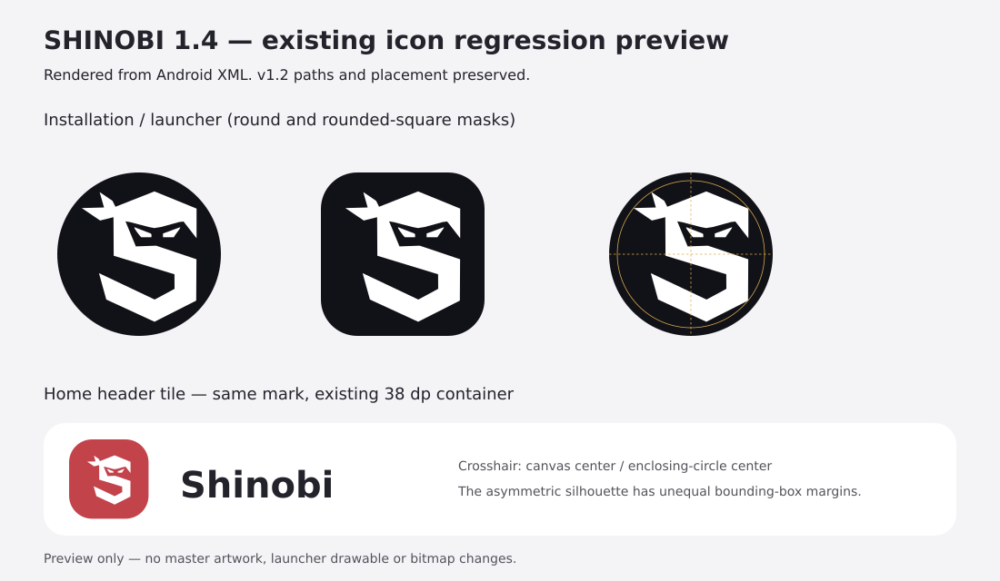

## SHINOBI 1.4 — draft release notes

**Not published; validation is incomplete.** At commit `b63df3c`, all 61 JVM tests and both APK builds pass. The Android emulator suite passes mixed-direction metadata display but fails three enlarged-text layout checks: the English and Arabic Find channels labels and the Mix Shorts with videos chip still report visual overflow. These must be resolved before release.

Cookie-free CI probes confirm that WEB and MWEB search return video results, anonymous Home returns no video renderers, and both clients return HTTP 400 for `FEtrending`. The Home search fallback addresses that dependency; regional Trending still needs a working upstream route before this task can be considered complete.

Version name **1.4**, version code **8**. Android 8.0 (API 26) or later.

### Changes under review

- **False connection errors:** an HTTP error, rate limit, timeout, malformed API response or DNS failure no longer implies the phone has no internet. Android's active network/captive-portal state is checked separately; an unvalidated VPN/network is not automatically called offline.
- **Feed recovery:** read-only requests use up to three attempts with 500 ms / 1 second exponential backoff plus jitter, bounded Retry-After handling, eight-second API deadlines and public WEB → MWEB fallback. Cancelling a screen request cancels its socket and backoff. Continuations stay with the client that issued them; private library reads never silently become anonymous feeds. Writes are not replayed by this policy.
- **Anonymous Home:** no longer depends on Trending being available. If YouTube Home is empty/unavailable, several independent broad-interest searches are interleaved in upstream rank order. These are a discovery fallback, not a claim to reproduce YouTube's private recommendation algorithm or its Trending chart.
- **Recommendations:** retains the existing separate discovery/history/like budgets, six-card personal-seed cap, diverse older history seeds, exclusions and creator/topic novelty penalties. Normal Home pagination now fetches only discovery continuations, not extra pages from personal seeds. Errors preserve the original reason and do not discard an already-visible feed. Try again starts a new request cycle.
- **Shorts:** the top shelf is retained; its discovery request runs alongside Home rather than serially after it. Traditional reel-endpoint video renderers are identified as Shorts, avoiding duplicate placement below the shelf.
- **Home chips:** one padded, horizontally scrollable row, case-insensitive deduplication of topic labels, no second For you row, no fixed chip height that clips enlarged text.
- **Subscriptions:** full-width one-line Find channels / Sign in actions; full-width empty-state cards with wrapping titles, including Automatic discovery.
- **Smart search:** retains 250 ms debounce, local prefix matches, bounded cache and stale-response cancellation. Adds a second Google suggestion host and a three-second per-attempt deadline.
- **Arabic + English:** retains isolated metadata runs and content-directed titles; strips embedded directional override controls from card titles and aligns full-size video titles to the interface direction.
- **Trending:** retains the country selector/cache and anonymous country-specific requests; removes the fixed legacy tab parameter, tries the mobile client for an empty chart, and parses its single-column layout. Missing regional charts remain explicitly unavailable rather than being replaced with invented trending results.

### Logo regression check

No master artwork, Android drawable, adaptive-icon descriptor or launcher bitmap was changed. Assets match **v1.2**. A fresh preview was rendered from the actual Android XML before building (the older overview preview in the repository was stale):

The existing enclosing-circle placement is centered to within 0.001 dp after Android XML rounding. The asymmetric silhouette has unequal bounding-box margins; no alignment redesign was made.

### Validation and limits

The release is gated on JVM regression tests, English/Arabic narrow-screen emulator layout tests at 130% text size, branding/zero-ads guards and both debug and minified release builds. JVM coverage includes read backoff, HTTP errors/Retry-After, actual socket cancellation, WEB/MWEB fallback and token affinity, malformed responses, recommendation source budgets, stale-request cancellation, pagination, search and mixed-direction metadata.

Public cookie-free endpoint probes from the CI runner are diagnostic only: YouTube may block shared/datacenter IPs, and regional charts may be empty or discontinued. An emulator/fixture pass does not verify every live response on a physical phone. Heavy-use frame timing, real-account sessions and all device/font/network combinations are not certified; universal zero-lag or uninterrupted YouTube availability cannot be guaranteed.

### Installation / signing

Download **Shinobi-1.4-release.apk** for normal use; the debug APK is for troubleshooting. The release APK is minified, but retains this repository's **debug-key signing configuration**. Its certificate may differ from an installed 1.3 APK, so an in-place upgrade is not guaranteed. Do not uninstall casually: removing the old app deletes local history, likes and settings. A stable private signing key is still needed for guaranteed future upgrades.
